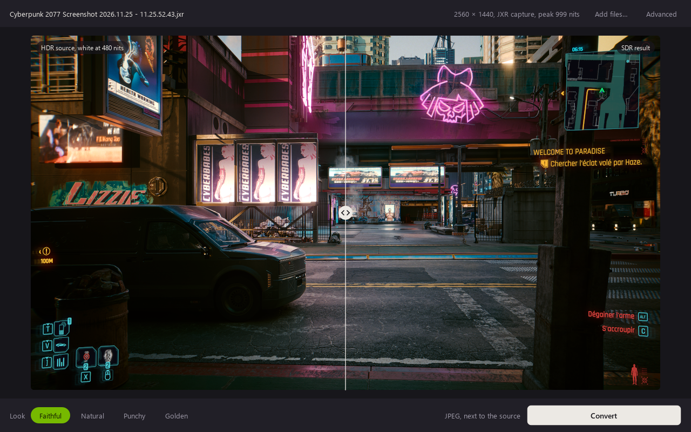

# NVIDIA HDR Converter GUI — HDR Blaster

**Version 3.1.3**

Convert NVIDIA HDR captures to SDR: JXR screenshots to JPEG or TIFF, and HDR10 recordings to
H.264 video, in one window. Version 3 of *NVIDIA HDR Converter GUI* is a new application,
called HDR Blaster; `NHC.py` still starts it.

<p align="center">
  
</p>

## What's new in 3.1.3

- **The picture on the right is the file.** Two faults added up. A capture opened in a
  maximised window could be rendered for the size the window had while it loaded
  (1170 × 658) and stretched to its place (2182 × 1227): grass and the outlines of wind
  turbines lost their detail. And the panel showed the picture before dither and JPEG
  compression: at the size of the file, it was up to 15 levels of 255 away from what was
  written. The right side now shows the decoded export, fitted to the window once it has
  its size. For JPEG it includes compression and dither; for TIFF it shows the 16-bit SDR
  samples; **Both** previews the JPEG. **Convert** writes those very bytes. What it costs:
  on a 2560 × 1440 capture a change of setting takes about 0.3 s to show (0.2 s for TIFF,
  0.45 s for Both) where the render alone took 0.04 s.
- Both formats carry an sRGB profile, and the same capture with the same settings gives
  the same file, byte for byte, from one run to the next. **Show in folder** selects the
  SDR result, including for TIFF-only exports.
- **A video can be inspected as it will be written.** **SDR before H.264** is the live
  view, for adjustments. **Preview encoded MP4** encodes the complete recording in a
  temporary folder and shows its decoded frames; **Convert** then saves that same MP4 when
  the source and the settings still match. The frames are decoded with exact rounding (the
  library's default conversion showed every pixel a level darker than the file holds).
- **Faithful and the three looks keep contrast inside the lights.** The roll-off of 3.1.2
  brought a scene under white by a curve that arrives flat: a sun and the sky around it
  both ended at white. From half a stop below white the upper tones now follow a shoulder
  whose slope stays positive up to the scene's peak, which lands on white. On the
  Cyberpunk sunrise, with SDR white at 480 nits, the solar disc is 9.6 % brighter than the
  adjacent sky (1.8 % in 3.1.2; the source measures 22.4 %), and the wind turbines in the
  glow can be told from it. The hue of a light does not move and a neon keeps its dark
  channel, as before. What is given up: the lights make room for one another, so what the
  source view shows as plain white is written around 240 of 255 on the sample captures
  (252 in 3.1.2), and a tone at the screen's white itself 233 (240) on that sunrise. In
  return a scene with a high peak keeps its mid-tones: under a white of 203 nits and a
  peak of 4000, a tone at half of white is written 188, as the scene has it (175 in
  3.1.2). A scene that fits under white is still returned as it came, and so are the
  shadows of every scene. For a video the fused stage gives the same bits as the plain one.
- **Perceptual** reserves one stop below white for bright structure. On the same sunrise
  it retains 7.47 % luminance contrast between the solar disc and the adjacent sky; the
  previous value was 0.87 % and the source measures 22.37 % (the same full-resolution
  pixels, sharpening and AI colour at zero).
- **Colours outside BT.709 are no longer cut on reading.** JXR and HDR10 decoding preserve
  signed scRGB values. Channel-based operators fit out-of-gamut colours at constant linear
  luminance before applying their curve; Perceptual fits them in ICtCp. On an HDR screen
  the source view shows them as recorded.
- Sharpening and AI colour protect the deep shadows of the anchored renderings, and a flat
  area is sharpened by nothing, up to the border of the picture.
- **The learned tone mapper has been taught again**, by the Punchy of this version, on
  recordings read with their signed colours. The model of 3.1.2 had learned the earlier
  roll-off: in the tones it renders it was 3.5 levels of 255 darker than today's Punchy on
  the sample captures. It is now 1.2 levels from it on average, and each capture has
  Punchy's exposure. Its deep shadows and its lights are bound to that look; the network
  renders the tones in between, and the finished picture is 30.5 to 40.8 dB from
  Punchy's. If its model cannot be loaded, the window says that Perceptual is used
  instead.
- Two operators are called by what they are: **Guided local contrast** (it was listed as
  Mantiuk06; the command line and saved settings keep `mantiuk06`) and **ACES filmic
  (Narkowicz)**. A flat peak rendered by Guided local contrast now reaches white.
- MP4 exports signal the sRGB transfer they are encoded with (BT.709 primaries and matrix,
  limited range, as before).

## What's new in 3.1.2

- **A light brighter than white is rendered as a light.** Faithful and the three looks
  brought a light under white with one gain, read on its brightest channel: it kept its
  whole colour and paid for it in luminance. The glow of a rising sun, a fifth of a
  Cyberpunk 2077 capture, came out as a flat peach surface: 999 / 852 / 684 nits were
  written 255 / 238 / 216 under a white of 480 nits, where the source view shows white.
  Now the brightest and the weakest channel of a light each go through the curve, and the
  middle one is placed between them so that the hue does not move. A glow whose three
  channels pass white burns towards white; a neon, whose weakest channel is far under
  white, keeps it as it is and stays a neon. On the sample captures the lights have the
  saturation of the source view again (0.20 for its 0.18 on that sunrise; 0.42 before).
  What is given up: inside a light far above white on its three channels, the detail that
  lived in its colour is fainter, as it is in the source view. Nothing under the roll-off
  moves, and a video costs 0.08 ms more a frame.
- This concerns Faithful, Natural, Punchy and Golden, captures and videos alike. The
  operators of the Advanced panel are as they were. The learned tone mapper was taught by
  the Punchy of before and still renders its lights.

## What's new in 3.1.1

- **The queue is a panel of its own, on the left of the picture.** With several files it
  slides in as Advanced does on the right, and the picture gives way to it. One row per
  file: a picture of it, whether it is a capture or a video, and where its conversion
  stands (the pass and its percentage, the file saved, or why it failed). The line of
  names under the action bar is gone.
- **The whole run can be followed**: the row at work fills as its file advances, a file
  that is done draws its tick, and a line under the title tells how far the list is.
- **A file that cannot be converted says so at once**: a video that is not HDR10 leaves the
  list as soon as it is read, instead of waiting to be chosen or converted.
- The *Queue* button, top left, shows and hides the panel and tells how many files wait.
  Up, Down and Delete walk the list; *Clear finished* takes the converted files out.
- A capture being converted no longer claims "0 %".
- **With two screens, the file is made for the screen the window is on, as its preview
  is.** The preview asked that screen what SDR white stands for; the conversion was
  answered by the first screen in HDR. With two HDR screens set to different "SDR content
  brightness" (or one in HDR and one not), the file was not the picture previewed: a grey
  of 40 nits shown at 102 of 255 was written at 82. The preview now also follows the
  window to another screen, and a change of that setting while the program is open.
- With a single screen in HDR nothing changes in the converted files: they are those of
  3.1.0.
- 3.1.0 was not published on its own: what it brought comes with this version, and is
  told below.

## What's new in 3.1.0

- **Videos convert a third faster again, with the same pictures, bit for bit.** A one-minute
  1440p recording at 120 frames per second took 1.8 minutes; it takes about 1.2 (0.9 at 60
  frames per second, 0.8 at 30). Each stage of a frame, from the recording's planes to the
  finished picture, is now one operation on the graphics card instead of dozens. A fused
  stage is used only after it has given, on your machine, exactly what the plain stage gives.
- **Both hardware encoders of the card are put to work** when it has two (an RTX 4090 does):
  the video is encoded in segments of 250 frames by two encoders that take turns. The file
  is the same whether they work at the same time or one after the other. If a second
  encoder is not to be had (other programs hold them, an older driver), one encoder encodes
  the whole video, as before.
- **At a lower frame rate, pictures reach the encoder without leaving the card.** The
  encoder gives the same packets as when they go through main memory; this too is checked
  on your machine before it is relied on.
- The pictures are those of 3.0.3; the encoded file is not byte for byte the one 3.0.3
  wrote when two encoders share the work: the same key frames, the same quality on average
  (within 0.2 dB on the recordings measured), single groups of frames a little above or below.

## What's new in 3.0.3

- **The program opens in about a second.** It took thirty. The standalone build is now a
  folder (`HDR_Blaster.exe` next to its libraries, published as one zip) instead of a single
  file that unpacked 2.6 GB to the temporary folder at every launch, and left them there
  whenever it did not close cleanly. Unzip it once, anywhere, and keep the two together.
- **The window no longer waits for the engine**: it opens at once, and a file can be shown
  about three seconds after the start. The converted files are the same, byte for byte.
- **The Advanced panel keeps its width** when a folder is chosen under *Save to*: its
  controls were cut off at the right. A long folder is shown on several lines.

## What's new in 3.0.2

- **Videos convert about three times faster, and write the same pictures.** They are
  decoded by the graphics card (NVDEC), and decoding, rendering and encoding run side by
  side. A one-minute 1440p recording at 120 frames per second took 5.9 minutes; it takes about 1.8.
- **Frame rate**: Original, 120, 60 or 30 frames per second. Frames are dropped, never
  invented: the ones that stay are the very ones the full conversion writes, with their own
  timestamps. The same recording takes 1.2 minutes at 60 and 1 minute at 30.
- **Motion blur at a lower frame rate**, if you ask for it: each frame written holds the
  light of the frames it replaces, added up in the scene's linear light as a longer exposure
  adds it. Motion is smoother and softer, and nothing is invented. (Textures blur as a camera
  blurs them; a sharp edge that crosses the picture fast shows as two or four stepped copies
  rather than one streak: the recording holds no picture between two of its frames.)
- **Videos are no longer sharpened unless asked** (*Sharpness and AI colour on videos*, in
  Advanced): nothing is then measured on their pictures, and they are analysed twice as fast.
- From 3.0.1: refined controls (pills, a segmented choice of looks, switches), and a click
  in the Advanced panel no longer moves the divider.

## What's new in 3.0.0

- **A new window** (Qt): drop a file, look at the HDR source and the SDR result on either
  side of a divider, convert. Four looks up front, everything else in an Advanced panel.
- **Videos**: HDR10 recordings are converted to H.264 SDR, with their audio untouched.
- **Faithful by default**: the result shows the scene at the luminance the game gave it;
  only what is brighter than your screen's white is rolled off (ITU-R BT.2390).
- **Every look and operator keeps the picture's dark tones and mid-grey.** They are
  variations of the same picture, not re-exposures of it, and each classical operator has
  a character of its own.
- **The HDR source is shown in real HDR** on a display with HDR switched on, as Windows'
  own viewer shows it.
- **The preview is the conversion**: rendered at the file's size, shown pixel for pixel.
- **Commands without the window**: `--convert`, `--convert-video`, `--version`.
- The author's image-adaptive 3D LUT colour models are unchanged (the *AI colour* setting).

## Features

### Core functionality
- **JXR captures** (HDR screenshots) to JPEG and/or TIFF
- **HDR10 recordings** to H.264 SDR video, never heavier than the source
- **Video on the graphics card from end to end**: decoded by NVDEC, rendered, encoded by
  NVENC, the three side by side. Without an NVIDIA card the processor decodes and encodes
- **Looks and operators** that keep what the game decided (see *Renderings*)
- **Batch processing**: several files or a folder, in a queue
- **The HDR source shown in real HDR.** On a display with HDR switched on, the picture area
  is presented in HDR (an scRGB surface, like Windows' own viewer): on the left of the
  divider the capture as the game showed it, with its lights far above the window's white;
  on the right the SDR result at the luminance an SDR window gives it on that screen. On a
  display without HDR the source is shown in the SDR window, cut at its white, and labelled so
- **Live preview** with before/after comparison and an optional histogram. Both pictures
  are rendered at the file's real size and brought to the window in a single Spline36
  resampling (anti-ringing, linear light when reducing); shown at the file's size they are
  its pixels, untouched

### AI colour enhancement
- **Image-adaptive 3D LUT** pretrained on the MIT-Adobe FiveK dataset (Zeng et al., TPAMI 2020)
- **Per-image LUT prediction**: a lightweight CNN blends 3 basis 33×33×33 LUTs based on each input's content
- **Pure-PyTorch trilinear interpolation** via `F.grid_sample` — no CUDA extension to compile
- **Edge enhancement** with Sobel filters and adaptive strength control
- **Half-precision (FP16)** support for memory-efficient GPU processing
- **~2.4 MB pretrained weights**, included in `models/3dlut/` (downloaded on first launch if missing)

### Renderings
A game's HDR picture is finished work. All the renderings keep its shadows while making
room for the highlights within SDR. The same rules apply: dark tones
are the scene's own, mid-grey stays mid-grey, the scene's peak lands on white. They differ
above the shadows.

- **Faithful** ⭐ keeps the scene's exposure through half a stop below SDR white. For scenes that
  exceed white, a smooth transition leads into a constant slope in log luminance for
  neutral highlights. This leaves room to distinguish the solar disc from the warm sky
  around it. The RGB channels keep their order and the middle channel keeps its relative
  position. Scenes that fit the display pass through the tone mapper unchanged.
- **Natural / Punchy / Golden** use the same positive-slope shoulder after three grades: softer with fading highlights; more
  contrast and colour; punchy in a warm light.
- The classical operators, each with the trait it is known for. (Held to the same shadows,
  mid-grey and peak, their published curves are the same curve to within a level or two;
  what tells them apart is how each treats the tones above the shadows.)
  - **Reinhard** — soft: nothing touched up to mid-grey, a gentle shoulder from there; bright
    colours go pastel.
  - **Hable** — film: more contrast in the mid-tones, muted colours, lights that fade.
  - **ACES filmic (Narkowicz)** uses the fitted filmic curve with strong contrast, rich mid-tones, lights that burn to white.
  - **Drago03** — flat: the whole range above the shadows compressed evenly, colours kept.
  - **Perceptual** reserves one stop below white for bright structure. It compresses ICtCp
    intensity and reduces chroma along a constant-hue ray until the colour fits SDR.
  - **Guided local contrast** uses two guided filters to reinforce local relief and retain fine
    detail. The command-line and saved-setting identifier remains `mantiuk06`.
- **Adaptive** — two of the operators, chosen from the picture and blended by brightness.
- **Auto-select** — one operator chosen from the picture's statistics (dynamic range,
  highlights, local contrast, saturation).
- **Neural (AI)** uses its learned HDRNet-style grid in the mid-tones. The current Punchy look
  anchors the shipped model in deep shadows and highlights. An unavailable model is reported
  as a fallback to Perceptual. See
  [`training/README.md`](training/README.md) to retrain or fine-tune.

### User interface
- **One window**: drop a file, look, convert
- **HDR source and SDR result side by side** under a divider you drag
- **Four looks** up front (Faithful, Natural, Punchy, Golden); everything else in an Advanced panel
- **The source view is the original**: Exposure and Gamma shape the result only
- **Queue panel** on the left for several captures and recordings: a picture of each file,
  what it is (capture or video) and where its conversion stands; progress and cancel on the
  one button
- **Video preview** with stabilized tone mapping after background analysis and exact MP4 inspection on demand
- **Frame rate of a video**: Original, 120, 60 or 30 frames per second, in Advanced, with
  motion blur made of the dropped frames if you switch it on
- **Videos are neither sharpened nor AI-coloured unless asked**: nothing is then measured on
  their pictures and the analysis is about twice as fast. *Sharpness and AI colour on videos*,
  in Advanced, applies both to videos as to captures
- **Nothing is ever overwritten**: results are written as `<name>_SDR`, numbered if needed

## Requirements

### System requirements
- **Windows 10 or 11** (built and tested there)
- **Python 3.14+**
- **NVIDIA GPU** (recommended) with CUDA support; the CPU path works but is slow
- **4GB+ RAM** (8GB+ recommended for large images)

### Python dependencies
```txt
torch==2.11.0
numpy==2.4.3
pillow==12.1.1
imagecodecs==2026.5.10
tifffile==2026.5.2
av==19.0.2
pyside6-essentials==6.12.0
```

**Install PyTorch first**, from the PyTorch index, to get the CUDA build:
`pip install torch --index-url https://download.pytorch.org/whl/cu130`.
The dependencies are declared in `pyproject.toml`; `requirements.txt` mirrors them.

## Installation

1. **Clone the repository:**
   ```bash
   git clone https://github.com/5ymph0en1x/NVIDIA-HDR-Converter-GUI.git
   cd NVIDIA-HDR-Converter-GUI
   ```

2. **Install dependencies:**
   ```bash
   pip install torch==2.11.0 --index-url https://download.pytorch.org/whl/cu130
   pip install -r requirements.txt
   ```

3. **Run the application:**
   ```bash
   python NHC.py
   ```

A standalone build (no Python needed) can be made with PyInstaller: a folder holding
`HDR_Blaster.exe` and its libraries, whose window opens in about a second. See
[`BUILD.md`](BUILD.md).

## Usage

### The window

```bash
python NHC.py            # or: python -m hdr_blaster
```

1. Drop a JXR capture, an HDR10 recording, several files or a folder on the window.
2. Look at the result: the unconverted picture is on the left of the divider, the
   converted one on the right. Drag the divider. For a video, the timeline chooses
   the frame. Select **Preview encoded MP4** to inspect the decoded output.
3. Pick a look if you wish (Faithful, Natural, Punchy, Golden) and press **Convert**.
   The classical operators, *Auto-select* and the neural operator are in Advanced, under Operator.

With several files, the queue opens on the left of the picture, as Advanced does on the
right: one row per file, with a picture of it, whether it is a capture or a video, and where
its conversion stands. Click a row to look at that file; the cross that appears on a row
takes the file out of the list; *Clear finished* takes out the converted ones. The *Queue*
button, top left, shows and hides the panel and tells how many files wait. A video that
turns out not to be HDR10 leaves the list by itself, and the window says why.

The result is written next to the source as `<name>_SDR.jpg` or `<name>_SDR.mp4`,
never over an existing file. Everything else (precise operator, exposure, sharpness,
AI colour, formats, video quality and size, destination folder, GPU or CPU) is in the
**Advanced** panel.

### Without the window

```bash
python NHC.py --convert capture.jxr [--method punchy] [--format JPEG|TIFF|Both]
python NHC.py --convert-video recording.mp4 [--method punchy] [--quality high|balanced|compact] [--height 1080] [--fps 60] [--blur]
python NHC.py --version
```

Both commands render Faithful unless told otherwise (`--method auto` lets the engine pick
an operator) and write `<name>_SDR` next to the source, never over an existing file.

Videos: HDR10 (PQ, BT.2020, 10-bit) recordings are converted to H.264 SDR with the
source's own timestamps and its audio copied untouched. The result is never heavier
than the source. A video takes no sharpening and no AI colour unless `--edge` or `--color`
ask for them (the analysis then renders every frame, and takes about twice as long).
`--fps` writes at most that many frames per second: for each tick of that clock the nearest
frame of the recording is kept, with its own timestamp; the others are left out, or, with
`--blur`, their light is added to the frame that replaces them (never across two shots).

## Technical architecture

### Processing pipeline
1. **Decoding**: a JXR capture (floating-point scRGB) or a frame of an HDR10 recording
2. **Rendering** with the chosen look or operator (**Faithful** by default); a video is
   analysed first, so that its measured parameters are steady within each shot. Decoding,
   computing and encoding run side by side; the fast path writes the very pictures of the
   plain one (`reference=True` in `hdr_blaster/video/job.py`), which the tests compare
3. **AI colour retouch** (optional) via the image-adaptive 3D LUT
4. **Edge enhancement** (optional)
5. **sRGB conversion**, dithering, and JPEG/TIFF or H.264 encoding

### AI enhancement architecture
```
                          ┌─ basis LUT 0 (3×33×33×33) ─┐
Input (downsampled 256²) → Classifier CNN → 3 weights →┤  basis LUT 1                ├→ combined LUT → trilinear lookup → Output
                          └─ basis LUT 2                ┘
```
The classifier (~440 K params) predicts 3 blending weights from a 256×256 downsampled view of the input.
The 3 basis LUTs are linearly combined into a single image-adaptive 3D LUT, then applied to the full-resolution image via trilinear interpolation (pure PyTorch `F.grid_sample`).
Total inference cost: ~600 K params, sub-millisecond on a modern GPU.

### Layout of the code
- `NHC.py` — the launcher
- `hdr_blaster/engine/` — the renderings (`renderings.py`), tone-mapping dispatch and the
  Auto-select choice (`tonemap.py`), the 3D LUT colour models (`lut3d.py`), sharpening
- `hdr_blaster/io/` — JXR reading; `hdr_blaster/video/` — HDR10 decoding, analysis, encoding
- `hdr_blaster/preview.py`, `hdr_blaster/resample.py` — what the window shows
- `hdr_blaster/ui/` — the window, and the HDR surface (`hdr_surface.py`)
- `training/` — the neural tone mapper: model, training code, shipped checkpoint
- `models/3dlut/` — the 3D LUT weights
- `tests/` — the test suite; `tools/` — icon generation, on-screen HDR check

### Tests
```bash
pip install pytest
python -m pytest
```
The tests need real captures: put a few `.jxr` files in `samples/` first (without them
most tests are skipped, and one fails to say so). Reading a capture, the colour models, the original sharpening and the files
written are checked bit for bit against a frozen copy of the original application
(`tests/legacy/`). On a display with HDR switched on, `HDR_BLASTER_ONSCREEN=1` adds a check
that reads back what the HDR surface presents.

## Supported formats

### Input
- **JXR captures** (JPEG XR, floating-point scRGB) from the NVIDIA app or Windows
- **HDR10 recordings** (PQ, BT.2020, 10-bit 4:2:0) in MP4, MKV or MOV

### Output
- **JPEG** (4:4:4, dithered) and/or **TIFF** for captures
- **MP4** (H.264, BT.709 primaries and matrix, sRGB transfer, limited range) for recordings, never heavier than the source

## Logging
- The window writes its log to `%LOCALAPPDATA%\HDR Blaster\hdr_blaster.log`
- The commands without the window write `hdr_converter.log` in the current folder

## Known limitations
- **HDR input only**: SDR, HLG and Dolby Vision files are refused with an explanation
- **Windows**: built and tested on Windows with an NVIDIA GPU; the CPU path works but is slow
- **Real HDR display of the source** needs Windows with HDR switched on for the screen the
  window is on; elsewhere the source is shown cut at the window's white
- **Video speed**: a one-minute 1440p recording at 120 frames per second (7,142 frames) converts in about 1.2 minutes on an RTX 4090 (analysis 235 frames per second, rendering and
  encoding 178), 1.9 minutes with sharpening, 0.9 minute at 60 frames per second and 0.8 minute at 30

## Troubleshooting
- **CUDA out of memory**: switch on *Half precision*, or switch off *Use the graphics card*, in the Advanced panel
- **A capture is refused**: only floating-point JXR captures (HDR screenshots) are accepted
- **A video is refused**: only HDR10 (PQ, BT.2020) recordings are accepted

## Acknowledgments
- **Hui Zeng et al.** for the [Image-Adaptive 3D LUT](https://github.com/HuiZeng/Image-Adaptive-3DLUT) model (TPAMI 2020) — pretrained weights used under Apache 2.0
- **MIT-Adobe FiveK** dataset (Bychkovsky et al.) used to train the LUT model
- **Qt for Python (PySide6)** for the interface, **PyAV / FFmpeg** for video
- **imagecodecs** for JXR decoding support
- **NVIDIA** for HDR screenshot format documentation

## License
This project is open source. Please check the [license file](LICENSE) for details.
